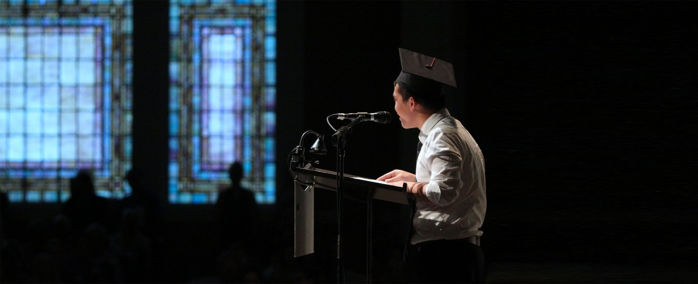

Sixty-five years after my grandfather was sent to study in Nanning, China, as part of the first cohort of Vietnamese young cadets, I left home to study in America at the age of 14. In 1949, the country was at war, and the government wanted to seed a generation of future leaders who could study safely, shielded from bombs and bullets. Upon returning, he volunteered as a highland soldier during the battle of Dien Bien Phu, which ended the First Indochina War. He believed in education and passed that belief to my parents, who supported sending me to boarding school in the US. While I shoulder a less serious burden than my grandfather’s, I wished to trailblaze a fulfilling education abroad like he did.

I arrived at my Seattle high school with little English and a strong will to make the most of my opportunities. I ran cross country as my first serious sport, becoming a team captain despite being a slow runner. I acted in the school’s annual musical production, where I played Pedro Segundo in "La Casa de los Espíritus." I also took French and wrote for the school newspaper, making me the only international student in any of these activities. For two years I served as the Student Residential Assistant, trusted as a leader who could break boundaries for what is typical of an international student. In contrast to the narrow focus of the Vietnamese public school system, my American teachers and coaches encouraged me to be equally good at STEM, arts, and athletics. In me, they valued dedication, community, and the courage to take on brand new challenges. These are the values I deem to be deeply American.

<figure style="margin:26px 0;text-align:center;">
  
  <figcaption style="font-size:12px;color:#777;margin-top:2px;">Seattle Town Hall, May 2015. Speaking at my high school graduation.</figcaption>
</figure>

Looking to continue a holistic education, I pursued the liberal arts at Haverford College, where I enjoyed interdisciplinary coursework in Economics, Statistics, and Mandarin. I wrote my senior thesis on the impact of home sharing on the New York City rental market, which became a compass for my belief that new technologies can drive positive societal change. We regularly had student-led discussions about social issues facing America: race, gender, and other identity conflicts. In America, you can love a country and still be fiercely critical of its shortcomings. It is possible to debate immigration politics and, in the same conversation, ask what the college can do for students from immigrant families. In the single-party political system I came from, such charged discussions are prohibited. I also led the Rugby Club for three years and, as an orientation leader, welcomed first-years as unsure as I had been. As a Student Interviewer in admissions, I spoke with 200 students over the years. An awareness of America’s complexity helped me contextualize them: what opportunities did they have, and what adversities did they overcome?

After Haverford, I looked for ways to pursue computer science more seriously. During the Covid-19 pandemic, I worked on a popular open-source natural language processing toolkit for Vietnamese. I expanded this interest at the University of Pennsylvania, where professors had published the Penn Treebank, a foundational corpus in computational linguistics. I constantly sought out mentors who could teach me research skills and spent most of my hours outside of the classroom thinking about large language models. By the end of my Master’s, I had written four papers, three of which I first-authored, and three of which were published at a major AI conference. Presenting my work at these venues brought me incredible joy. With four other graduate students, I also formed a team for the NFL Big Data Bowl. We modeled the optimal running path for kick returners and became one of three finalists. I felt incredibly grateful to combine my passions for American football and AI, a pairing only possible in the US. To me, America is interdisciplinary and fun. It is also a place where I can be a free scholar and nourish a curiosity I hope to pursue for a long time.

Today, at Apple, I put language model technologies into the hands of millions of users through Apple Intelligence. In my first year, I led the training of three features that help users respond to messages on their watch, proofread their writing, and create smart actions via their phone cameras. Although frontier models are exceedingly capable, they still struggle with translation and make common homophone errors in languages with little representation in the data.

After the war, my grandfather returned to teach Mathematics at the village high school, where he dedicated the rest of his life. Though we never met, I feel connected to him in our experience as curious foreign students who adapt to new environments and pay our fortune forward. My favorite work at Apple has been fixing weaknesses for low-resource languages while keeping the model equally small and efficient, giving Vietnamese speakers the access that English speakers take for granted. The toolkit I contributed during the pandemic is still used by many Vietnamese researchers. And as a volunteer for STEAM for Vietnam, an expat-organized initiative that provides free coding classes to children in all 54 provinces, I led a team of four data scientists in analyzing learning outcomes and improving course design, which raised the graduation rate by 20% between the first and second cohorts. As my grandfather had carried his education home, I can carry mine to Vietnamese speakers and New Americans who arrived the way we did.

Returning to school for a PhD in Computer Science will allow me to work on fully open research. In industry, I worked on stable training recipes that improve sharply with careful interventions on the training data. In a PhD, I can go beyond the data to quantify the science of language model training, which will allow other researchers and practitioners worldwide to own intelligence at a fraction of the cost. Being a New American means I can continuously pursue bold science that can bridge my American and Vietnamese identities.
